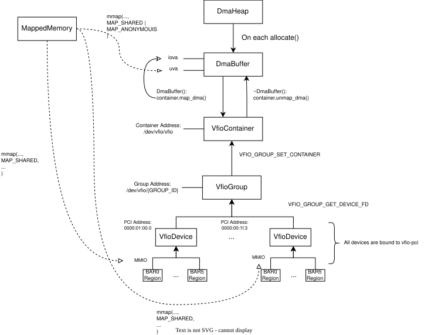

# User Space NVMe Driver

Build and run:

```sh
cmake -S . -B build -DCMAKE_BUILD_TYPE=Debug
cmake --build build

# RUn:
./build/src/nvme_driver
```

This is a user space NVMe driver that supports NVMe base specification revision 2.3. The implemented driver is for memory-based NVMe devices. Message based NVMe controller is not implemented yet, though I'm not sure whether I will even add support for it :)

TODO:
- ~PCI device discovery~
- ~BAR mapping~
- ~controller reset/enable~
- ~admin queue setup~
- ~Identify Controller~
- ~Identify Namespace~
- ~Create I/O CQ/SQ~
- ~Basic read/write operations~
    - ~write + read "Hello world" at a LBA~
- PRP construction (use PRP lists for data more than a memory page)
- ~Polling completions~
- Implementing MSI-X Interrupts and benchmarking polling vs interrupts
- Asynchronous event notifications (AEN) implementation
- ~A good abstraction over commands / queues / command execution (admin vs io)~
    - not good yet, i will try to improve more
- Per-core queue pairs
    - one queue pair per pinned thread + NUMA cores?
    - one completion poller per core
    - benchmark with different queue depths (1, 8, 32, 128)
- Controller memory buffer support
- Maybe turn this into a Linux loadable kernel module?


Benchmarking:
- Benchmark against Linux pread/write without kernel caching
- Benchmark against SPDK

## Some Diagrams to Help With the System:

### Linux VFIO Setup in this project:



### NVMe Setup in this project:

TODO